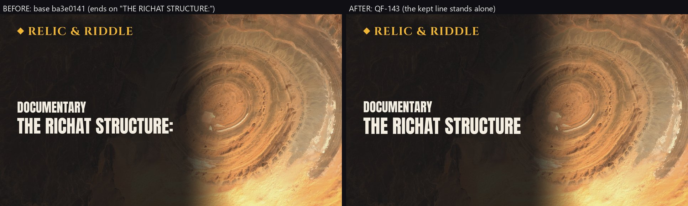

# QF-143: a YouTube thumbnail headline stands alone (no trailing colon, no fragment); showcase triage

Round 2 (review 1, 8/10, 2026-11-16) changed three things. A whole authored line is judged by its own rules,
not by the QF-141 remainder classes (finding 1). The review card states the true reason (finding 2). The base
failure count is corrected and the measure's predicate is now independent (finding 4). Finding 3, a year drawn
twice, was there before this row and is filed for lane B.

Source: the before/after showcase of 2026-11-16 (real dev runs, tip ba3e0141). The Richat documentary's 16:9
thumbnail (dev run `run_richat_structure_sahara_eye_1792740961_long`) drew "DOCUMENTARY" over "THE RICHAT
STRUCTURE:". The headline ended on a colon that led into a line the thumbnail does not draw.

## Why line 2 is not drawn

The run's thumbnail copy is line1 "THE RICHAT STRUCTURE:" and line2 "THE EYE OF THE SAHARA" (eyebrow "DOCUMENTARY",
tagline "EXPLORE THE EVIDENCE"). There is no figure, so the two-tone headline path runs, with three words per line.

- Before QF-23, `_words` cut line 2 to its first three words, "THE EYE OF" (the pre-QF render in the showcase).
- QF-23 (b948f7f3, operator decision option 1 in `decisions/QF-23-thumbnail-question.md`) keeps the budget and
  selects whole lines, never cutting one. Line 2 has five words, so it is left out whole
  (`headline_lines_dropped: ["line2"]`). Round 4's kicker (9619fb76) then fills the empty slot from the eyebrow.
- Neither change looked at what the kept line says once it is alone. Line 1 ends on the colon that introduced line 2.

The subtitle cannot be kept here unless the ruled budget changes. Five words over a three-word line is a word
budget, not a size problem, and the size steps cannot fit it. Option 3 (raise the budget) was not chosen. The
script-stage rule that gives a documentary short thumbnail lines is QF-109. This row does not change which lines
are drawn. It makes the line that is drawn stand alone.

## Fix (`src/youtube_thumbnail.py`)

- `_end(text)`: the last drawn headline line loses any mark at its end that leads on to further text: a colon,
  semicolon, comma, ampersand, plus, slash or dash. A colon that leads into a drawn line 2 stays.
- `_alone(text)`: a line drawn without the copy line written with it (the budget left that one out, or the copy has
  none) loses that mark. If it still dangles, it is not drawn alone. The rules are for a whole line the writer
  chose, not for the remainder of a cut field (round 2). A line closed by its own ?, !, . or ellipsis always stands.
  Otherwise it dangles when:
  - it ends on an article, a preposition that takes an object, or a conjunction (AND, OR, BUT, NOR): "SECRETS OF
    THE", "CARVED FROM", "BUILT BY". IN is left out because it is also an adverbial particle ("LOCKED IN"). The
    copulas and relatives that `cover_design._JOINERS` adds for QF-141 remainders are left out too, because they end
    complete lines ("HERE IT IS", "WHAT IT WAS", "GUESS WHO");
  - it opens on OF or THAN: it carries on a phrase from the line before ("OF THE ANDES");
  - it opens on AND, OR, BUT or NOR and the next word does not start a clause of its own. A subject pronoun or a
    sentence adverb starts one ("AND THEN NONE", "BUT NOBODY KNEW", "AND IT VANISHED"). Anything else, such as an
    article or a noun, carries on a list from the line before ("AND THE SPHINX"). This rule is measurable without
    a parser. Its known limit is a conjunction followed by a full noun-phrase clause ("AND THE WALLS FELL"): that
    line is refused, and the recorded eyebrow or tagline fallback is drawn. No copy is invented.

  The fallback is then the existing QF-23 one: another verified line (the eyebrow, then the tagline) that stands
  alone, else no headline. It is recorded as `headline_fragment` and `headline_from` or `headline_dropped`. The
  review card's `headline_note` gives the true reason ("... does not stand alone without the line written with
  it", round 2; it said the budget before). The YouTube thumbnail's qa.json gets `headline_fragment`.
- Both paths use it: the no-figure two-tone headline and the figure or year hero's title line, including the
  title-overlap and eyebrow/tagline alternatives.
- No word is cut and none is added. Only a trailing mark is removed. Topic-agnostic: word classes and marks only.

## Measurements (`measure.py`; `before.json`, `after.json`, `comparison.json`)

There are 46 cases, each drawn by `VisualEngine.generate_youtube_thumbnail` as a run draws it, offline:

- 5 catalogue covers (freeze-panel fixtures, with their heroes);
- 4 script-library payloads;
- 37 dev runs: every `output/run_*` in the main checkout with a payload, read only.

The heroes are the covers survey's still, or for the documentary the still that best matches its delivered
thumbnail, or else the topic's first photo. The production sample was not used.

| | base ba3e0141 | this commit |
|---|---|---|
| headlines ending on a leading mark (":" etc.) | 1 (Richat documentary) | 0 |
| headlines ending on a dangling fragment | 0 | 0 |
| copy line 2 (subtitle) drawn | 35 of 46 | 35 of 46 (unchanged: the 11 others are over the ruled budget) |
| cases whose headline is unchanged: pixel-identical | | 45 of 45 |
| render errors | 0 | 0 |

The one changed case is the Richat documentary: "DOCUMENTARY" over "THE RICHAT STRUCTURE:" becomes "DOCUMENTARY"
over "THE RICHAT STRUCTURE". The fragment rule has no real case today. It is exercised by the regression test's
grid: 9 copy forms on the no-figure and year paths. On the base, 8 of the 9 fail by assertion; "GUESS WHO?" is a
control that passes on both. Round 2 adds 17 whole authored lines labelled by hand (the test's own table, not the
code's predicate): 9 must stand, with the kicker over them kept, and 8 must not. On the base the 9 stand and the 8
fail. In all, 29 tests pass here; on the base 18 fail by assertion with 0 errors, and 11 pass. In round 1, 348 tests
in the 14 files that use the thumbnail passed. The fragment predicate in `measure.py` is now its own written-out
word list, independent of the code (review 1, finding 4).

## Triage of the showcase's other findings (no code in this row)

| Finding | Where it came from | Ruling | Class |
|---|---|---|---|
| Grid tile (Wieliczka): "327 METERS DOWN" withheld, nothing in its place | QF-141 (2b128665) drops the "DOWN" fragment. The figure is withheld under r7 (9619fb76): the sheet hedges 327 m and the copy has no qualifier | r7 operator default (a hedge that cannot be shown means the figure is not shown) and QF-141. A replacement line is QF-141's open question 1, unruled. Nothing is invented | Design question, lane B: should an emptied tagline fall back to another verified line (sub-theme, carousel heading)? Also operator question "ESTIMATED as a qualifier" (OPERATOR-QUESTIONS.md) |
| Greek fire Reel cover: privacy-blur discs on the manuscript's faces | Not a code change. The catalogue hero (`fixtures.json` covers, greek_fire_siphon) is the run's privacy copy `cache/privacy/01_commons_2cb3dd9c04510a9f_bcf0fcf0364f53e3.jpg`, written 2026-10-23 00:07, before 1cd9d28a (the same day: "never blur faces in artwork"). Today `privacy.is_artwork(assets/greek_fire_siphon/01_commons.jpg)` is True (Madrid Skylitzes, "manuscript"), so a new run does not blur it. The 0dd2ffd6 render shows the same discs. The whole-photo framing that shows all of them is the photograph-first cover (pre-programme, 11-01/02) | Artwork is never blurred (1cd9d28a; QF-50 keeps the artwork flag) | Not a defect in code. Stale input, lane B: re-point the catalogue's Greek fire hero to the asset (or a fresh privacy pass) before judging the cover |
| Map 9:16 (Richat): "ADRAR PLATEAU, MAURITANIA" subtitle lost | Pre-programme: `sub_label` (city, country) left `_render_map` in 581a8666 (maps WIP, 2026-11-05), after round 6 (2026-11-03): "the label nearest the marker is the site's name, never the country's; the floating site title ... gone". The country is named in its fill. The 0dd2ffd6 render has no subtitle either | Round-6 map design (coordinator), not a QF row | Design question, lane A: the region ("ADRAR PLATEAU") is now drawn nowhere. Should a site's region or city have a place on the locator? 581a8666 is marked "wip ... not review-passed", so lane A should treat this as a possible unreviewed regression, not settled design (review 1) |
| End card 9:16: block left of the frame's centre | QF-24 centres the block in the Reel safe rectangle x 113..848 (centre 480.5, 59.5 px left of 540), clear of the Reels action buttons. Measured on the showcase: about 59 px left. QF-83's move of FOLLOW to the loop bridge (ruling Q5) is not the cause; the share line was already one centred block | QF-24/QF-87 layout decision of 2026-11-09 and operator 2026-11-13 "keep area, fix surfaces" (the look goes to the design-freeze loop) | Design question, lane E: centre in the frame or in the safe box on a card with no UI of its own over it |

Also seen while measuring (lane B, no code here):

- The no-figure headline is not checked against the video title. Only the figure hero's subject line gives way
  (`title_overlap`). The Richat documentary's "THE RICHAT STRUCTURE" repeats its YouTube title "The Richat
  Structure: Geological Evidence ...".
- 11 of 46 thumbnails draw no copy line 2, because it is over the three-word line budget. QF-109 (a script-stage
  rule that writes short thumbnail lines) is the ruled route.

## Files

- `measure.py`: `python measure.py` sweeps this tree and prints the after summary. `sweep` and `compare` give the
  before/after.
- `before.json`, `after.json`, `comparison.json`: the summaries and the changed case.
- `richat_documentary_youtube_before_after.jpg`: half size, the real run's hero and copy.
- Regression test: `tests/test_qf143_headline_stands_alone.py`.
